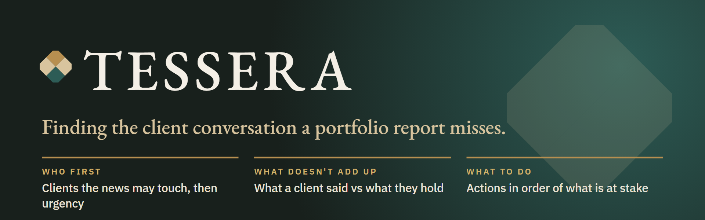
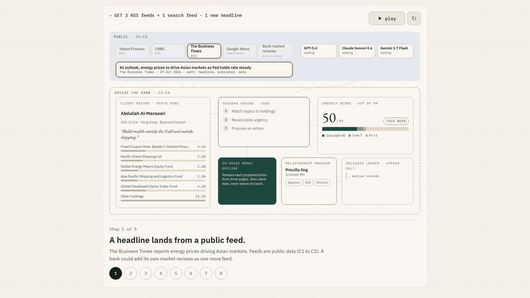
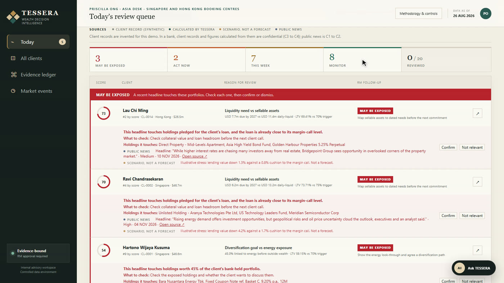
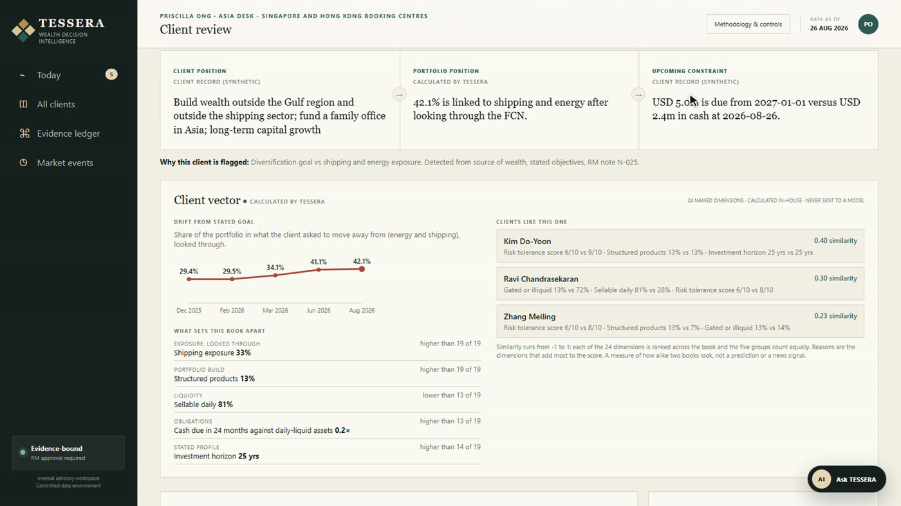
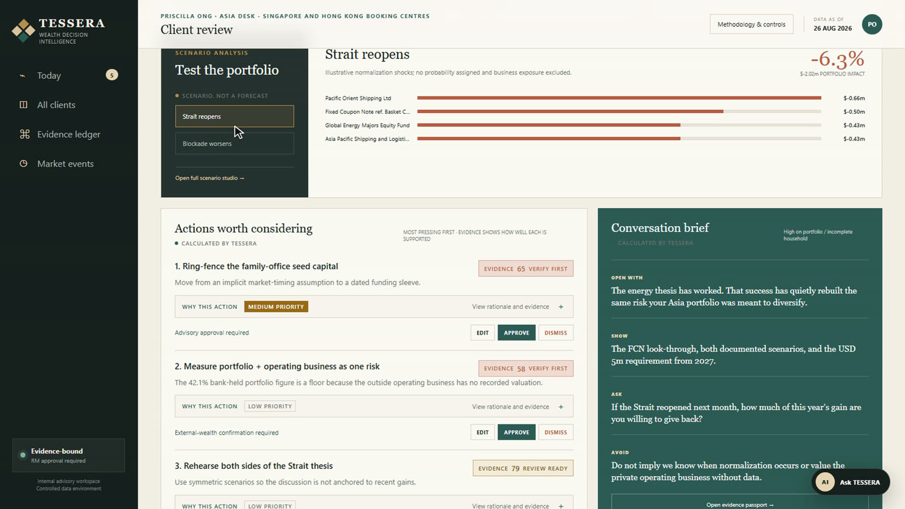
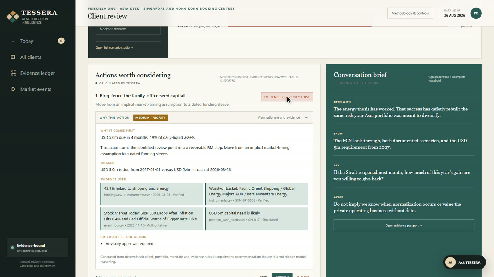
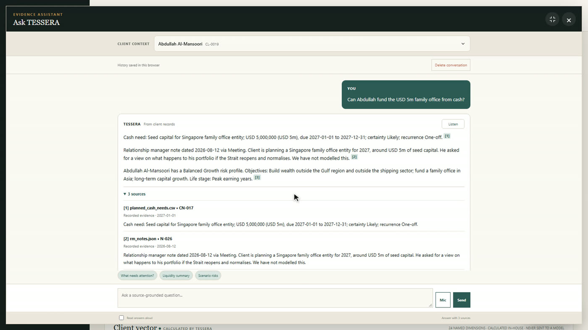
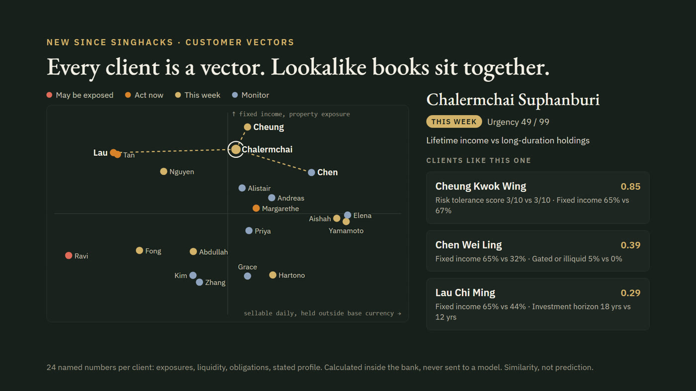
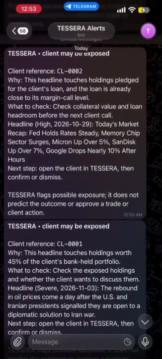
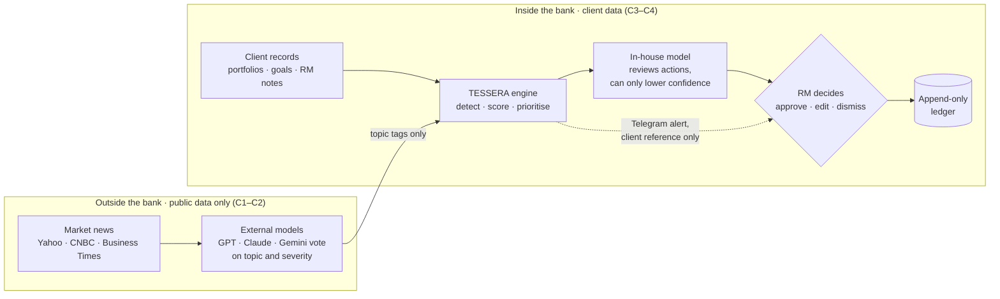

<p align="center">
  
</p>

<p align="center">
  <a href="https://singhacks-jb-wealth-intelligence.vercel.app"></a>
  <a href="https://alicia112233.github.io/SingHacks2026/"></a>
  <a href="https://alicia112233.github.io/SingHacks2026/slides.html"></a>
</p>

<p align="center">
  <b>Code calculates. AI reads. The RM decides.</b><br>
  SAPTrio · Julius Bär Wealth Intelligence track · SingHacks 2026 · Singapore FinTech Festival finalist
</p>

---

TESSERA helps wealth-management Relationship Managers prepare for client reviews. Every morning it answers three questions for every client in the book: **who to look at first**, **what doesn't add up** between what the client said and what they hold, and **what to do about it**, with the evidence behind every number.

Built for SingHacks using controlled, non-production records. All clients are synthetic. The application supports human review and does not place trades.

## One headline, followed all the way through

<p align="center">
  
</p>

Public news comes in and three outside models tag it. Inside the bank, code matches the tags to each client's holdings and rescores urgency. The bank's own model reviews the proposed action, the RM approves it, and the ledger records the decision. Step through it yourself on the [explainer site](https://alicia112233.github.io/SingHacks2026/walkthrough.html).

## The case that shows why

> **Abdullah asked us to build his wealth outside the Gulf and outside shipping.**
> His portfolio is up 26% this year, so every report says *great year*. Look inside his structured note, and **42.1%** is shipping and energy, the same bet as the business he owns. It has drifted from **29.4% to 42.1%** in eight months. He also needs **USD 5m** next year, with USD 2.4m in cash.
>
> No portfolio report flagged this. TESSERA puts it at the top of his page.

## Walk through a client review

<table>
  <tr>
    <td width="50%"><br><b>1 · Prioritise.</b> One queue: clients a fresh headline may touch come first, then lanes by urgency score.</td>
    <td width="50%"><br><b>2 · Investigate.</b> What the client said, what the portfolio does, and the cash they need, on one screen.</td>
  </tr>
  <tr>
    <td><br><b>3 · Explore.</b> Transparent scenarios, labelled as scenarios, not forecasts, with the holdings that drive them.</td>
    <td><br><b>4 · Evaluate.</b> Actions in order of what is at stake. How well each is supported is scored separately.</td>
  </tr>
  <tr>
    <td><br><b>5 · Ask.</b> Client-scoped answers where every line cites its source record. Missing evidence produces a refusal.</td>
    <td><br><b>6 · Compare.</b> Every client as 24 named numbers, calculated inside the bank. Lookalike books sit together.</td>
  </tr>
</table>

<table>
  <tr>
    <td width="190"></td>
    <td><b>7 · Follow up, away from the desk.</b><br>When a headline may touch a client, TESSERA sends a Telegram alert with the client reference, never the name, plus why it was flagged and what to check. Urgent reviews get reminders and escalation until the RM acknowledges them. In a bank, the same alerts would run on the bank's own messaging.<br><br><b>8 · Decide.</b> The RM approves, edits or dismisses each action. Every decision is written to an append-only ledger with its evidence version, so a change of mind is a new record, never an overwrite.</td>
  </tr>
</table>

Today shows the clients that need attention; **All clients** shows the complete queue. **Reviewed** means the review was recorded, not that the underlying exposure disappeared. Dictation and read-aloud in **Ask TESSERA** depend on browser support. Local factual retrieval works without cloud credentials; semantic retrieval is optional.

## How it works



Client records never leave the bank. Outside models only see public headlines, never a client. Code does every calculation; models read and tag text, and can only lower a confidence score, never raise it.

## The review queue

| Lane | Rule | What the RM does |
| --- | --- | --- |
| 🟥 **May be exposed** | An illustrative stress on the holdings a recent headline touches crosses a hard line: the margin-call level, a 12-month funding gap or a 5% loss of bank-held assets | Check the exposure, then confirm or dismiss |
| 🟧 **Act now** | Urgency score 70 or above | Review today |
| 🟨 **This week** | Urgency score 45 to 69 | Plan the conversation |
| 🟩 **Monitor** | Urgency score below 45 | Keep watching |

A client flagged by a headline sits under **May be exposed** whatever their score, and their score rank stays visible. News can add at most 8 urgency points, so daily noise cannot dominate the ranking; real exposure is flagged instead.

## What the scores mean

| Measure | Scale | Question it answers |
| --- | --- | --- |
| **Urgency** | out of 100 | Which client review needs attention first? |
| **Priority** | out of 100, High / Medium / Low | Which of this client's actions is most pressing? Set by what is at stake: money due and how soon, distance to a limit or margin call |
| **Evidence** | out of 100, capped at 84 | How well is this particular action supported? |
| **Similarity** | −1 to 1 (cosine) | How alike are two clients' books, across 24 named numbers? |
| **Risk indicators** | 1 to 5 | What do the records say about capacity, tolerance and horizon? |

None of these is a probability of a positive return. The analytical layer uses illustrative sensitivities rather than calibrated forecasts, which is why evidence is capped at 84. Similarity describes how alike two books are; it is not a prediction that news will hit them the same way.

## Six shifts since SingHacks

| | Shift | What changed |
| --- | --- | --- |
| 1 | **Client data stays in the bank** | Outside models only read public headlines; actions are reviewed by the bank's own model |
| 2 | **Screening, not predicting** | A headline tells the RM which clients it touches and what to check, with no forecast |
| 3 | **Detection for any client** | Code compares each client's own words with their holdings; no client is named in the rules |
| 4 | **Every figure labelled** | Each number says what it is: client record, calculation, scenario or public news |
| 5 | **Customer vectors** | 24 named numbers per client: drift from their own goal, what sets them apart, and lookalike books |
| 6 | **Most pressing first** | Actions are ordered by what is at stake; evidence is scored separately |

## Run locally

From the repository root, with Python available:

```powershell
cd singhacks-jb-wealth-intelligence
python -m venv .venv
.\.venv\Scripts\python.exe -m pip install -r requirements.txt
.\.venv\Scripts\python.exe app.py
```

Open **http://127.0.0.1:5000**. On macOS or Linux, replace `.\.venv\Scripts\python.exe` with `.venv/bin/python`.

Use the application server, not a static file server: review actions need its API. Restart after backend changes. Append `--port 8000` to use another port.

The core demo needs no cloud credentials. Live RSS news is enabled by default and needs network access. For optional integrations, copy `.env.example` to `.env.local` inside the application directory. Never commit credentials. The template enables Chroma retrieval; set `TESSERA_RETRIEVAL_ENABLED=false` if you are not configuring Chroma.

## How review controls work

Deterministic code calculates portfolio measures, validates evidence and applies approval gates. Proposed actions carry client data (C3–C4), so only the bank's in-house model may review them. It can challenge or lower an assessment, but cannot override a hard stop or raise the deterministic score. The demo has no in-house model, so one labelled stand-in plays that role (`TESSERA_INHOUSE_MODEL` points it elsewhere). External models only ever see public headlines.

Recommendation IDs and evidence versions reject stale decisions. Material edits require reassessment, and saved model-panel restrictions survive reloads. Approving an action records a decision; it does not automatically reduce evidence-based urgency.

See the [Recommendation Risk Rubric](singhacks-jb-wealth-intelligence/docs/RECOMMENDATION_RISK_RUBRIC.md).

## Development

The browser interface uses HTML, CSS and JavaScript. Python handles analysis and review services, with pandas for tabular data, a local HTTP server for development and Flask for the hosted API. Hosted ledgers use PostgreSQL; Chroma is an optional semantic retrieval integration. Dependencies are listed in the application's `requirements.txt`.

### Project structure

Application paths are under `singhacks-jb-wealth-intelligence/`.

| Path             | Purpose                                                               |
| ---------------- | --------------------------------------------------------------------- |
| `app.py`       | Local HTTP server and optional alert monitor                          |
| `api/index.py` | Hosted Flask API                                                      |
| `web/`         | Browser interface and styles                                          |
| `tessera/`     | Analysis, evidence validation, review state, storage and integrations |
| `data/`        | Controlled source records                                             |
| `runtime/`     | Local generated state and ledgers                                     |
| `tests/`       | Regression tests                                                      |
| `docs/`        | Rubric and integration guides                                         |

### Verification

From the application directory, using the environment with dependencies installed:

```powershell
python -m unittest discover -s tests -v
node --check web/app.js
```

Node is needed for the JavaScript syntax check. Notification tests use mocked delivery. Tests do not establish live Telegram delivery, external-model behaviour or hosted PostgreSQL correctness; those need separate deployment checks.


## Hosting and limitations

Vercel hosting uses the Python API and PostgreSQL-backed ledgers. Hosted review writes require `DATABASE_URL`; local JSON storage is intended for one server process. See [deployment setup](singhacks-jb-wealth-intelligence/DEPLOYMENT.md).

Only `TESSERA_MODE=demo` is supported. Other modes reject intelligence preparation and dependent review operations. This is not authentication: anyone who can reach the demo can access its sample data. Real client use requires authenticated identities, client-level authorisation and a separate security review.

Follow-up deadlines come from the controlled snapshot and may already be overdue. Hosted news, analytical snapshots and chat outputs use the shared PostgreSQL store; `/all-clients` supports direct navigation and refresh. Alert locking prevents concurrent duplicate sends, but a crash after Telegram accepts a message and before state is saved can still cause a repeat.

## Documentation

- [Explainer site: walkthrough, project map, book map, slides](https://alicia112233.github.io/SingHacks2026/)
- [Application setup and operating notes](singhacks-jb-wealth-intelligence/README.md)
- [Product model](SOLUTION.md)
- [Architecture and workflow](singhacks-jb-wealth-intelligence/README_SOLUTION.md)
- [Recommendation Risk Rubric](singhacks-jb-wealth-intelligence/docs/RECOMMENDATION_RISK_RUBRIC.md)
- [Evidence chat assistant](singhacks-jb-wealth-intelligence/docs/RAG_CHAT_ASSISTANT.md)
- [Chroma Cloud setup](singhacks-jb-wealth-intelligence/docs/CHROMA_CLOUD.md)

---

<p align="center"><sub>Built by <b>SAPTrio</b> for SingHacks 2026 · Julius Bär Wealth Intelligence track. Synthetic data only.</sub></p>
